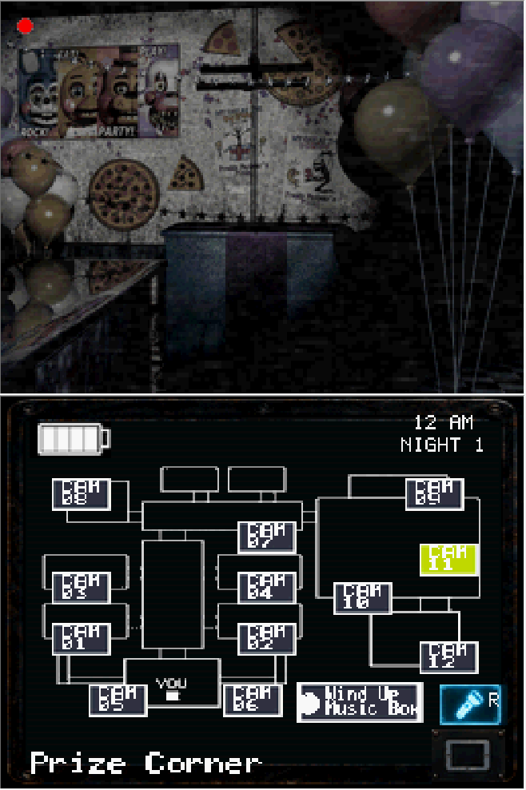

# Five Nights at Freddy's 2 — Nintendo DSi / DSi XL (V19.7)

> Fan-made, non-commercial homebrew project and open-source technical portfolio.

[🇧🇷 Português](#português) · [🇺🇸 English](#english)

## Português

### Sobre
Recriação experimental de mecânicas de **Five Nights at Freddy's 2** para **Nintendo DSi / DSi XL**, desenvolvida como demonstração pública de competências em programação de sistemas, lógica de jogos, integração audiovisual e otimização para hardware limitado.

**Versão publicada:** V19.7 (nome definido para o lançamento). O funcionamento de cada recurso deve ser validado no console antes de anunciá-lo como totalmente estável.

### Funcionalidades desenvolvidas ao longo do projeto
- Escritório, corredor, ventilações, máscara e tablet de câmeras.
- Lanterna, caixa de música, movimentação e comportamento dos animatrônicos.
- Introdução com aviso, título, assinatura, anúncio de emprego e cutscenes.
- Telas de carregamento, Game Over e vitória das 6 AM.
- Ajustes de IA e balanceamento por noite, incluindo Custom Night.
- Interface dividida entre as duas telas do Nintendo DSi.

### Galeria real / Actual screenshots

As imagens abaixo foram fornecidas pelo desenvolvedor e preservam o enquadramento das duas telas.

| Título | Inicialização | Escritório | Câmeras | Vitória |
|---|---|---|---|---|
|  |  |  |  |  |

### Arquivo histórico e metodologia

O arquivo `VERSION_AUDIT.md` contém a análise de **12 ROMs normais** preservadas (V0.7 a V19.0), com tamanho, SHA-256 e evidências de textos de diagnóstico embutidos. Builds `-LOG` não foram contadas como versões independentes. **Presença de texto em binário não garante funcionalidade testada.** V19.1–V19.7 não constam do ZIP histórico enviado.

### Destaques técnicos
- **Linguagem:** C/C++.
- **Ferramentas:** devkitARM / devkitPro, libnds (conforme dependências do código-fonte), Git.
- **Plataforma-alvo:** Nintendo DSi XL real; testes adicionais em emulador.
- **Restrições:** memória limitada, renderização em duas telas e orçamento de processamento.
- **Engenharia:** máquinas de estados, gerenciamento de assets, integração de áudio, lógica de IA, depuração e testes incrementais.

### V19.7 — notas de versão
A V19.7 sucede os ajustes registrados na V19.6.2:
- Tela inferior de loading com seleção variável de linha e posição inicial.
- Janela de reação de pelo menos 1,5 segundo para Withered Freddy, Bonnie e Chica após surgirem, antes da exigência de máscara.
- Correções anteriores de fluxo inicial e configuração 20/20/20/20 para dez animatrônicos.

> Essas notas descrevem o histórico de desenvolvimento. Validar a ROM V19.7 final no hardware antes de marcar os itens como verificados.

### Compilação
1. Instale **devkitPro / devkitARM** e as dependências exigidas pelo `Makefile` do projeto.
2. Clone este repositório.
3. Na pasta do código-fonte, execute `make` (caso o projeto utilize o Makefile padrão).
4. Teste o `.nds` gerado em um Nintendo DSi compatível com homebrew.

**Importante:** publique o `Makefile`, fontes e arquivos necessários à compilação. Não inclua ROMs ou assets originais de terceiros sem permissão de redistribuição.

### Download
A ROM **V19.7** poderá ser disponibilizada em **GitHub Releases**, após revisão dos direitos dos assets incluídos e testes finais.

### Portfólio profissional
Projeto criado para demonstrar habilidades de desenvolvimento de software, resolução de problemas, adaptação a limitações de hardware e evolução iterativa de um produto.

**LinkedIn:** https://www.linkedin.com/in/felipe-alexandre-7763b41a6/  
**GitHub:** https://github.com/agonisingbasher

### Direitos autorais e licença
Five Nights at Freddy's e seus personagens pertencem aos respectivos titulares. Este projeto é independente, não oficial, sem afiliação e sem fins comerciais.

**Código-fonte:** licença a definir após auditoria de código e dependências. Publicar o código não concede direitos de redistribuição sobre arte, música, efeitos sonoros ou outros materiais de terceiros.

## English

### Overview
Experimental, non-commercial **Five Nights at Freddy's 2** homebrew adaptation for **Nintendo DSi / DSi XL**, built as a public software-engineering portfolio project.

**Release:** V19.7. Features and stability should be confirmed on real hardware before being marked as verified.

### Technical highlights
- C/C++ programming and devkitARM-based homebrew development.
- Dual-screen interface, security cameras, flashlight, mask, and animatronic AI.
- Memory-aware asset handling, game-state logic, audio integration, and debugging.
- Iterative balancing, loading sequences, game-over and victory screens.

### Build
Install the dependencies required by the included source and Makefile, then run `make` from the source directory. Verify the resulting `.nds` on compatible homebrew hardware.

### Disclaimer
Unofficial fan-made work. The Five Nights at Freddy's franchise and associated assets remain the property of their respective owners. Source-code licensing does not cover third-party content.

**LinkedIn:** https://www.linkedin.com/in/felipe-alexandre-7763b41a6/

## Vídeo de demonstração / Gameplay video

A página inclui uma demonstração real gravada em **emulador de Nintendo DSi no computador**. O arquivo é `site/videos/fnaf2-dsi-gameplay-v19.7.mp4` (H.264/AAC; 658 × 972; aproximadamente 2m40s). A miniatura está em `site/images/gameplay-poster.jpg`. O vídeo não deve ser descrito como filmagem do console físico.

The site features gameplay footage captured on a **Nintendo DSi emulator running on a PC**, not on original hardware. The video uses a native HTML5 player and loads on demand.

## Reimplementação e UX para duas telas

O projeto é uma **reimplementação homebrew baseada no estudo e engenharia reversa de comportamentos**, não um porte direto do executável de Windows. Além de recriar mecânicas, foram criados controles e fluxos próprios para o DSi XL: seleção de câmeras na tela inferior, luzes, máscara, tablet, menu, carregamentos personalizados, Game Over, relatório de vitória e Continue para a próxima noite. A interface de **Custom Night** foi projetada para ajustar níveis de IA diretamente no console; o funcionamento final deve ser confirmado com a ROM V19.7 distribuída.

### Comparativo técnico

| Original para PC (Steam) | Nintendo DSi XL |
|---|---|
| 1 GB RAM (mínimo publicado) | 16 MB RAM física |
| CPU 2 GHz Pentium 4/Athlon | CPUs ARM9 + ARM7 |
| Gráficos: 1 GB (requisito anunciado) | Duas telas de 256×192 pixels |
| 250 MB de armazenamento livre | Execução homebrew via devkitARM |

As especificações não constituem comparação direta de desempenho nem medição de memória consumida. Fontes: [Steam](https://store.steampowered.com/app/332800/Five_Nights_at_Freddys_2/) e [manual Nintendo DSi](https://assets.nintendo.eu/image/upload/v1635390257/NAL/Support/DSiOperationsManual.pdf).

### Vídeo demonstrativo

A gravação original de emulador possui margens pretas embutidas; a versão integrada ao site foi **recortada para 250×370**, preservando as duas telas e o áudio. Gravação feita em emulador no computador, não no console físico.
