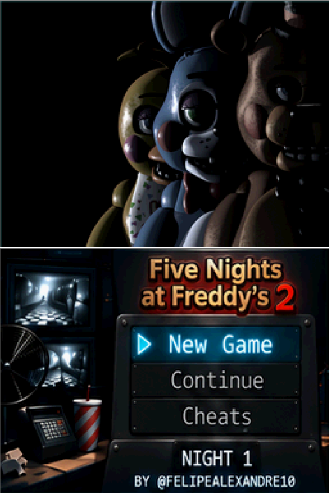
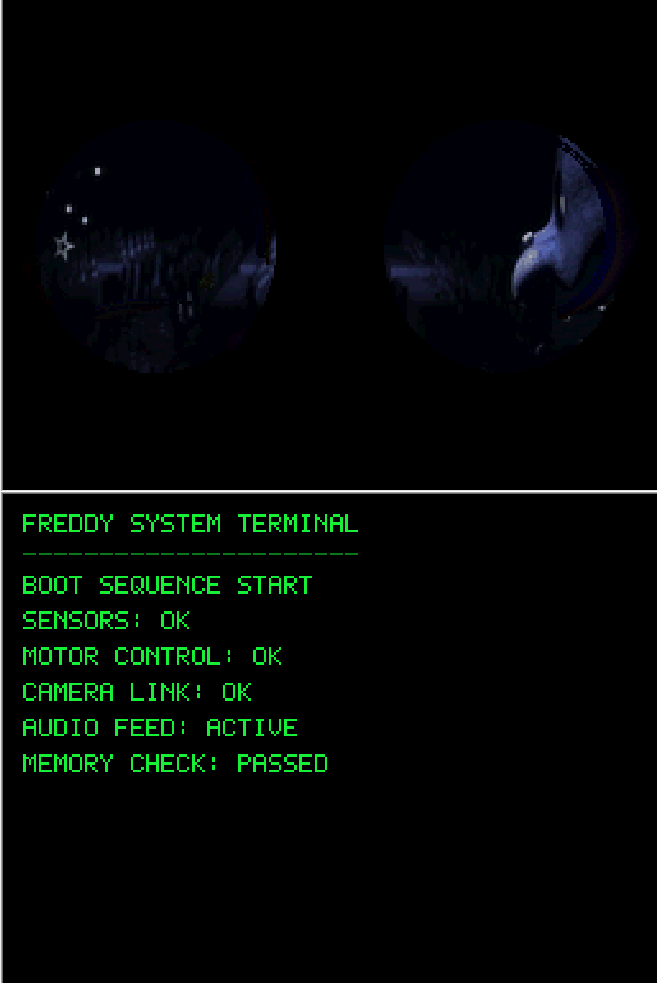
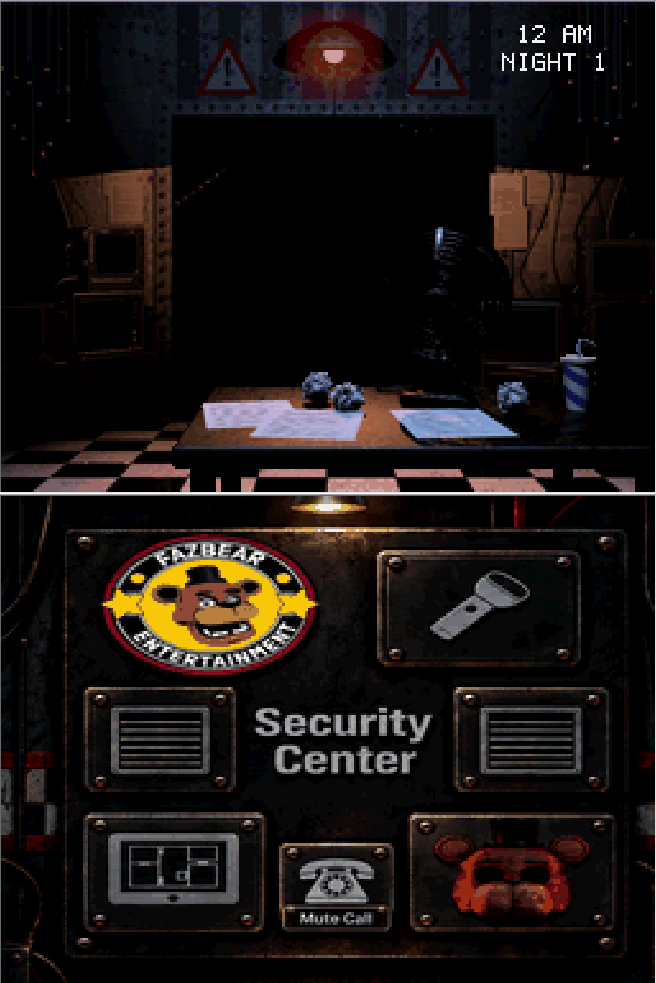

# <center> 🎮 Five Nights at Freddy's 2 — Nintendo DSi XL</center>

### Reverse Engineering • C/C++ • Homebrew • Dual-Screen UX

[](https://github.com/agonisingbasher/FNAF2-DSi-Reverse-Engineering) [](https://github.com/agonisingbasher/FNAF2-DSi-Reverse-Engineering) [](https://github.com/agonisingbasher/FNAF2-DSi-Reverse-Engineering)

> **Not a direct PC port.** An independent homebrew reimplementation of game mechanics and a custom interface designed specifically around the Nintendo DSi's **two screens**.

---

## 🚀 About the Project

This technical portfolio project explores **reverse engineering of observable game behavior**, software reimplementation and interaction design under strict hardware constraints. Rather than transferring the Windows executable to the handheld, the development recreates systems in **C/C++** and adapts player interactions to the DSi form factor.

The goal is to demonstrate hands-on skills relevant to **Junior Software Developer**, **C/C++ Developer**, **Gameplay Programmer** and **Software Engineering** roles: decomposition of complex requirements, architecture, debugging, performance trade-offs, UI/UX and iterative delivery.

---

## 📸 Screenshots — Real Project Captures

The images preserve the two stacked DSi screens. Screenshots are from the project itself.

| Main Menu | Boot Sequence | Security Office |
|:---:|:---:|:---:|
|  |  |  |

| Interactive Cameras | Night Complete |
|:---:|:---:|
|  |  |

### ▶️ Gameplay Demonstration

Watch the [gameplay recording](Docs/videos/fnaf2-dsi-gameplay-v19.7.mp4) or open the [interactive showcase website](https://agonisingbasher.github.io/FNAF2-DSi-Reverse-Engineering/).

**Capture disclosure:** this video was recorded on a **Nintendo DSi emulator running on a PC**, rather than on the original console.

---

## 🎯 Features & Development Work

* 🎥 **Dual-screen camera monitoring:** camera switching through the touch-enabled lower screen, with the selected room rendered above.
* 🔦 **Interactive survival controls:** flashlight, side vent lights, Freddy mask, tablet and physical button interactions.
* 🤖 **Animatronic AI systems:** movement logic, route progression, behavior windows and per-night balancing.
* 🎬 **Custom loading & transitions:** boot terminal, animated loading, menus and introductory sequences.
* 🏆 **Victory & progression UX:** 6 AM animation, shift summary, Continue and Game Menu.
* 🌙 **Custom Night:** interface for configuring animatronic difficulty; verify complete behavior against the released V19.7 build.
* 🐛 **Incremental debugging:** investigation of crashes, asset memory constraints, UI state transitions and gameplay issues.

**Why dual-screen design matters:** the lower screen is not just a mirrored display. It serves as an **interactive control surface**, while the upper screen focuses on the gameplay view. New controls and custom UI flows were designed for this interaction model.

---

## 🧠 Reverse Engineering vs. Direct Porting

| Direct PC port | This DSi reimplementation |
|---|---|
| Attempts to adapt existing PC application code/runtime | Recreates observed systems and behavior using homebrew C/C++ code |
| Original PC-oriented interaction model | Dual-screen touch and physical-control design |
| Assumes comparatively generous desktop resources | Works within the DSi memory, display and processing constraints |
| Largely retains the source application's presentation | Adds custom boot flow, loaders, menus, results and interaction patterns |

*Reverse engineering* here describes studying and reproducing functionality/behavior; it does **not** imply access to the original game's source code.

### ⚙️ Hardware & Requirements Context

| Category | Original PC minimum (Steam listing) | Nintendo DSi / DSi XL |
|---|---|---|
| Memory | 1 GB RAM | 16 MB system RAM |
| CPU | Pentium 4 / Athlon 2 GHz | ARM9 + ARM7 |
| Display / graphics | PC graphics requirement listed as 1 GB | Two 256 × 192 displays |
| Storage | 250 MB available space | Homebrew ROM deployed to console storage |

These are **different hardware architectures**, not a like-for-like performance benchmark. The PC requirements describe the original game, not the measured memory footprint of this homebrew program. References: [Steam](https://store.steampowered.com/app/332800/Five_Nights_at_Freddys_2/) · [Nintendo DSi manual](https://assets.nintendo.eu/image/upload/v1635390257/NAL/Support/DSiOperationsManual.pdf).

---

## 🛠️ Technologies & Engineering Concepts

<div style="display: inline_block">
  
  
  
  
</div>

**Toolchain:** devkitPro / devkitARM and the libraries required by the source's `Makefile` (confirm dependencies before building).  
**Concepts:** gameplay state machines, hardware-aware resource handling, asset pipelines, AI logic, UI/UX, debugging and regression testing.

---

## 🕒 Development Timeline

The archived ROM collection and earlier project records cover an iterative progression from the earliest prototypes to later builds:

* **V0.7–V0.13:** early menu, office, camera, audio and game-over development.
* **V0.14–V0.17.1:** timing diagnostics, camera controls and resource iteration.
* **V0.18–V19.0:** introductory scenes, boot fixes and victory/UI elements.
* **V19.1–V19.7:** continued gameplay fixes, loading transitions, AI balancing and two-screen polish described in project development notes.

See [VERSION_AUDIT.md](VERSION_AUDIT.md) for evidence from the archived ROMs. **Text extracted from a binary alone does not prove a feature worked correctly.** The supplied historical archive did not contain every later build's source history.

---

## 🏗️ Building From Source

1. Install **devkitPro / devkitARM** and dependencies listed in the project's `Makefile`.
2. Clone this repository:

   ```bash
   git clone https://github.com/agonisingbasher/FNAF2-DSi-Reverse-Engineering.git
   ```

3. Enter the source directory containing the `Makefile`, then run `make` if supported by that build configuration.
4. Test the resulting `.nds` in a compatible emulator or on homebrew-enabled DSi hardware.

> The source tree, Makefile, assets and ROM are to be added separately. The README alone is not a verified, reproducible build.

---

## 📦 Releases

**V19.7** — planned/current project milestone. The distributable ROM should be published in [GitHub Releases](https://github.com/agonisingbasher/FNAF2-DSi-Reverse-Engineering/releases) **only after testing and confirming that its bundled materials can legally be redistributed**.

---

## 👨‍💻 About the Developer

**Felipe Alexandre** — Developer in training, interested in software engineering, full-stack development, systems programming and AI-assisted workflows.

* 🔗 [LinkedIn](https://www.linkedin.com/in/felipe-alexandre-7763b41a6/)
* 💻 [GitHub Profile](https://github.com/agonisingbasher)

---

## ⚖️ Copyright & Open-Source Notice

This is an **unofficial, non-commercial fan project**, with no affiliation with or endorsement by the owners of *Five Nights at Freddy's*. Original characters, names, visual artwork and audio remain the property of their respective rights holders. **An open-source code license does not grant redistribution rights to third-party assets.** Choose and document a code license only after checking source ownership and dependencies.

---

### 💡 Building, learning and transforming technical constraints into software solutions.

⭐ Thanks for visiting this project!
