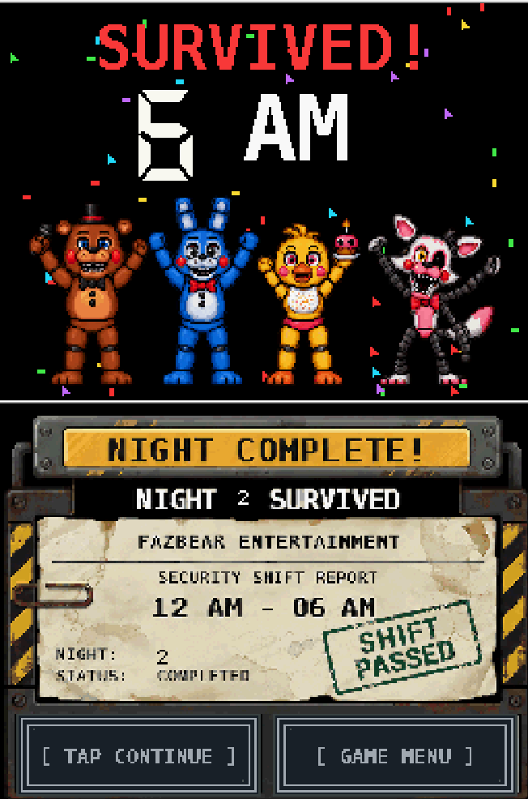

<h1 align="center">🎮 Five Nights at Freddy's 2 — Nintendo DSi XL</h1>

<h3 align="center">Reverse Engineering • C/C++ • Homebrew • Dual-Screen UX</h3>

  
  
  

> **Not a direct PC port.** An independent homebrew reimplementation of game mechanics and a custom interface designed specifically around the Nintendo DSi's **two screens**.
> This technical portfolio project studies **observable game behavior** and reimplements systems in C/C++. It is not a port of the Windows executable, and no access to the original FNAF 2 source code was available.

---

## 🚀 About the Project

This technical portfolio project explores **reverse engineering of observable game behavior**, software reimplementation and interaction design under strict hardware constraints. Rather than transferring the Windows executable to the handheld, the development recreates systems in **C/C++** and adapts player interactions to the DSi form factor.

The goal is to demonstrate hands-on skills relevant to **Junior Software Developer**, **C/C++ Developer**, **Gameplay Programmer** and **Software Engineering** roles: decomposition of complex requirements, architecture, debugging, performance trade-offs, UI/UX and iterative delivery.

---

## 📸 Screenshots — Real Project Captures

These images preserve the two stacked DSi screens and come from the project itself. All screenshot files are stored directly in the repository's **`docs/`** directory.

| Main Menu | Boot Sequence | Security Office |
|:---:|:---:|:---:|
|  |  |  |

| Interactive Cameras | Night Complete |
|:---:|:---:|
|  |  |

### ▶️ Gameplay Demonstration

Watch the [gameplay recording](docs/fnaf2-dsi-gameplay-v19.7.mp4) or open the [interactive showcase website](https://agonisingbasher.github.io/FNAF2-DSi-Reverse-Engineering/).

**Capture disclosure:** The gameplay video was recorded on a **Nintendo DSi emulator running on a PC**, not directly on the original console.

> **File paths:** The image links above assume the files are named `title.png`, `boot.png`, `office.png`, `cameras.png` and `victory.png` directly inside `docs/`. If your uploaded filenames differ in spelling, capitalization or extension, update the links to match them exactly. The video link assumes `docs/fnaf2-dsi-gameplay-v19.7.mp4`; adjust the filename if your uploaded video is named differently.

---

## 🎯 Features & Development Work

* 🎥 **Dual-screen camera monitoring:** Camera switching through the touch-enabled lower screen, with the selected room rendered above.
* 🔦 **Interactive survival controls:** Flashlight, side vent lights, Freddy mask, tablet and physical button interactions.
* 🤖 **Animatronic AI systems:** Movement logic, route progression, behavior windows and per-night balancing.
* 🎬 **Custom loading & transitions:** Boot terminal, animated loading, menus and introductory sequences.
* 🏆 **Victory & progression UX:** 6 AM animation, shift summary, Continue and Game Menu.
* 🌙 **Custom Night:** The V19.6.2 source implements ten AI values (0–20), named presets, touch/button navigation and starting Night 7. This is not proof of full validation in published ROM V19.7 or physical hardware; preset names do not establish faithful original rules.
* 🐛 **Incremental debugging:** Investigation of crashes, asset memory constraints, UI state transitions and gameplay issues.

**Why dual-screen design matters:** The lower screen is not just a mirrored display. It serves as an **interactive control surface**, while the upper screen focuses on the gameplay view. New controls and custom UI flows were designed for this interaction model.

---

## 🧠 Reverse Engineering vs. Direct Porting

| Direct PC port | This DSi reimplementation |
|---|---|
| Attempts to adapt existing PC application code/runtime | Recreates observed systems and behavior using homebrew C/C++ code |
| Original PC-oriented interaction model | Dual-screen touch and physical-control design |
| Assumes comparatively generous desktop resources | Works within the DSi memory, display and processing constraints |
| Largely retains the source application's presentation | Adds custom boot flow, loaders, menus, results and interaction patterns |

*Reverse engineering* here describes studying and reproducing functionality/behavior; it does **not** imply access to the original game's source code.

### ⚙️ Hardware & Requirements Context

| Category | Original PC minimum (Steam listing) | Nintendo DSi / DSi XL |
|---|---|---|
| Memory | 1 GB RAM | 16 MB system RAM |
| CPU | Pentium 4 / Athlon 2 GHz | ARM9 + ARM7 |
| Display / graphics | PC graphics requirement listed as 1 GB | Two 256 × 192 displays |
| Storage | 250 MB available space | Homebrew ROM deployed to console storage |

These are **different hardware architectures**, not a like-for-like performance benchmark. The PC requirements describe the original game, not the measured memory footprint of this homebrew program. References: [Steam](https://store.steampowered.com/app/332800/Five_Nights_at_Freddys_2/) · [Nintendo DSi manual](https://assets.nintendo.eu/image/upload/v1635390257/NAL/Support/DSiOperationsManual.pdf).

---

## 🛠️ Technologies & Engineering Concepts

  
  
  
  

**Toolchain:** devkitPro / devkitARM and the libraries required by the source's `Makefile` (confirm dependencies before building).  
**Concepts:** Gameplay state machines, hardware-aware resource handling, asset pipelines, AI logic, UI/UX, debugging and regression testing.

---

## 🕒 Development Timeline

The archived ROM collection and earlier project records cover an iterative progression from the earliest prototypes to later builds:

* **V0.7–V0.13:** Early menu, office, camera, audio and game-over development.
* **V0.14–V0.17.1:** Timing diagnostics, camera controls and resource iteration.
* **V0.18–V19.0:** Introductory scenes, boot fixes and victory/UI elements.
* **V19.1–V19.3:** See the version-specific source notes for memory/startup history; the 1,075,172-byte ARM9 text+data+BSS figure is a V19.3 record only and excludes gameplay allocations.
* **V19.4–V19.5.1:** Supplied notes cover the 5→6 AM transition, two-screen victory, Game Over, and loading/interface changes for those revisions.
* **V19.6–V19.6.2:** The supplied source includes per-night reaction windows, Custom Night settings and tests. Its validation report is limited to V19.6.2.
* **V19.7:** The ROM in this repository is identified as V19.7. No supplied source or evidence demonstrates equivalence with the available V19.6.2 source.

See [VERSION_AUDIT.md](VERSION_AUDIT.md) for archived ROM evidence. **Strings found in a binary do not prove that a feature worked.** The supplied historical archive did not contain every later build's source history.

---

## 🏗️ Build prerequisites and source availability

The source archive and browsable extraction are identified as **V19.6.2**, while the ROM in `Rom/` is identified as V19.7. **ROM publicada: V19.7. Fonte disponibilizada: V19.6.2.** No supplied evidence establishes that the two are equivalent.

### Repository contents and validation

- `Rom/FNAF2-V19.7.nds` — published ROM file.
- `Rom/FNAF2-V19.6.2-Codigo-Fonte.zip` — preserved source archive.
- `source/FNAF2-V19.6.2/` — archive extracted without changing its build layout; includes source, assets, NitroFS files, tests, previews, reference assets, Makefile and ARM7 ELF input.
- `docs/` — portfolio site, project images, emulator-recorded gameplay video and player guide at `docs/guide.html`.

The source's `VALIDATION.json` records V19.6.2 only: 18 automated suites, 462 NitroFS files verified, CRC/SHA-256 and ROM structure checks for NORMAL/DEV builds, and `hardware_tested: false`. The V19.6.2 release notes state it was not tested in an emulator or on a physical DSi. These historical records were read, not rerun for this update and are not evidence of V19.7 validation.

The Makefile requires `DEVKITARM`, `$DEVKITARM/ds_rules`, the included `ds7_maine.elf`, assets and NitroFS data; some asset-generation scripts use Python/Pillow. The files do not establish that all host dependencies are available or that a clean build succeeds. No reproducible-build claim is made. The game's source was not changed or built for this site/documentation task.

A scan for common credential/private-key markers found no obvious secrets in the archive; this is not a comprehensive security audit. The ARM7 ELF is retained because the Makefile explicitly references it as a build input. No extra build/cache directories or object intermediates were added.

### License and third-party material

No explicit license for the authored source code was found in the repository or archive. No license has been chosen on the developer's behalf. FNAF characters, artwork, audio and other third-party assets remain distinct from authored code; publishing code does not grant redistribution rights for third-party material.

Browse the extracted [source tree](source/FNAF2-V19.6.2) or download the preserved [source ZIP](Rom/FNAF2-V19.6.2-Codigo-Fonte.zip).

---

## 📦 Releases

**V19.7** — current documented project milestone. The distributable ROM should be published in [GitHub Releases](https://github.com/agonisingbasher/FNAF2-DSi-Reverse-Engineering/releases) **only after testing and confirming that its bundled materials can legally be redistributed**.

---

## 👨‍💻 About the Developer

**Felipe Alexandre** — Developer in training, interested in software engineering, full-stack development, systems programming and AI-assisted workflows.

* 🔗 [LinkedIn](https://www.linkedin.com/in/felipe-alexandre-7763b41a6/)
* 💻 [GitHub Profile](https://github.com/agonisingbasher)

---

## ⚖️ Copyright & Open-Source Notice

This is an **unofficial, non-commercial fan project**, with no affiliation with or endorsement by the owners of *Five Nights at Freddy's*. Original characters, names, visual artwork and audio remain the property of their respective rights holders. No explicit license for the authored source code was found in the repository/archive, and no license was selected for the developer. **Publishing code does not grant redistribution rights to third-party assets.**

---

### 💡 Building, learning and transforming technical constraints into software solutions.

⭐ Thanks for visiting this project!
